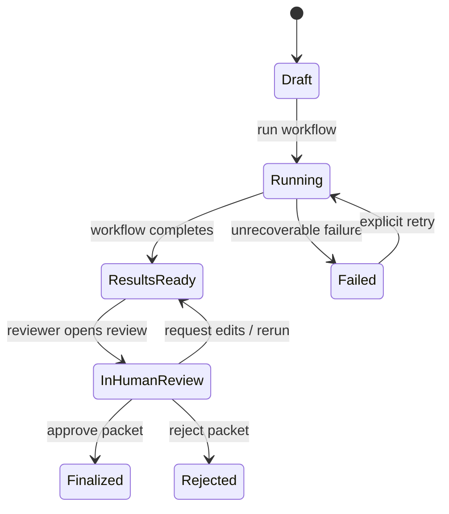

# AuthOS — API Contract (Proposed)

**Status:** Draft contract derived from `system-architecture.md` and `PLAN.md`. No running API has been verified. Pydantic schemas should become the executable source of truth during implementation.

## General rules

- JSON over HTTP. All MVP routes use the `/api/v1` prefix for a consistent, explicitly versioned contract. Keep this prefix consistent in frontend clients, tests, and OpenAPI.
- Validate all inputs and outputs with Pydantic.
- Never accept a client-supplied patient ID as authority to cross case boundaries; load patient and policy identity from the persisted case.
- Do not return full chart text by default. Return source excerpts required for evidence review.
- Use stable machine-readable error codes and a human-readable `message`.
- MVP is local/demo-only with synthetic data. Authentication is not in the initial hackathon scope, but must be designed before any real data or shared deployment.

## Proposed endpoints

| Method | Path | Purpose | State change |
|---|---|---|---|
| `GET` | `/api/v1/cases` | List synthetic demo cases and their state. | No |
| `GET` | `/api/v1/cases/{case_id}` | Get case metadata, service and policy identifiers. | No |
| `POST` | `/api/v1/cases/{case_id}/run` | Start/re-run policy criteria analysis and evidence retrieval. | Yes; creates run/audit events |
| `GET` | `/api/v1/cases/{case_id}/results` | Return criterion results, evidence citations, retry log and validator flags. | No |
| `POST` | `/api/v1/cases/{case_id}/review` | Record reviewer notes or a documented gap disposition. | Yes; audit required |
| `POST` | `/api/v1/cases/{case_id}/approve` | Record explicit human action: approve packet for finalization, request edits, or reject finalization. | Yes; audit required |
| `GET` | `/api/v1/cases/{case_id}/packet` | Retrieve packet only when finalization state permits it. | No |
| `GET` | `/api/v1/eval/ablation` | Optional, local-only evaluation summary. | No |

The exact distinction between a reviewer accepting a gap and approving packet finalization must remain explicit in the implementation. Neither action represents insurer approval.

## Proposed response contracts

### Criterion result

```json
{
  "criterion_id": "C2",
  "status": "MET",
  "verified": true,
  "evidence": [
    {
      "source_id": "PT_NOTE_004",
      "patient_id": "P-104",
      "quote": "Patient completed PT from March 4 through April 22.",
      "document_date": "2026-04-22",
      "retrieval_round": 2
    }
  ],
  "missing_facts": [],
  "retry_log": [],
  "validator_flags": []
}
```

Example values are synthetic illustrations, not test results. `status` must be one of `MET`, `MISSING`, `AMBIGUOUS`, `CONTRADICTED`. A `MET` result requires `verified=true` and at least one valid supporting evidence item, unless a separately documented policy exception model is implemented and validated.

### Review action

```json
{
  "criterion_id": "C3",
  "action": "request_information",
  "note": "Please attach the missing follow-up note."
}
```

Allowed actions should be a closed enum defined in `contracts/schemas.py`; do not accept arbitrary action strings. Reviewer identity must come from authenticated server context in any multi-user deployment, not from a trusted client field.

### Finalization action

```json
{
  "action": "approve_packet",
  "reviewer_note": "Reviewed the cited evidence and documented gaps."
}
```

Allowed actions: `approve_packet`, `request_edits`, `reject_packet`. These are human workflow decisions about the packet, not insurance outcomes.

## Error envelope

```json
{
  "error": {
    "code": "CASE_NOT_FOUND",
    "message": "The requested case was not found.",
    "request_id": "req_example"
  }
}
```

Initial error codes: `VALIDATION_ERROR`, `CASE_NOT_FOUND`, `RUN_ALREADY_IN_PROGRESS`, `INVALID_STATE_TRANSITION`, `VERIFICATION_FAILED`, `PACKET_NOT_FINALIZED`, `INTERNAL_ERROR`. Do not expose prompts, secrets, stack traces or full clinical text in error responses.

## State transitions to enforce



A packet must not be returned as finalized before the human approval action is persisted. Idempotency behavior for `run` and `approve` must be decided before shared deployment; for the local MVP, prevent duplicate concurrent runs and record each action.

## Contract tests required

- Every endpoint validates invalid IDs and malformed payloads.
- Invalid state transitions return a stable error.
- Packet retrieval before approval does not return a finalized packet.
- A validator-rejected evidence item cannot produce a `MET` result.
- Review and finalization actions produce audit records.
- Patient identity and source ownership are checked server-side.
