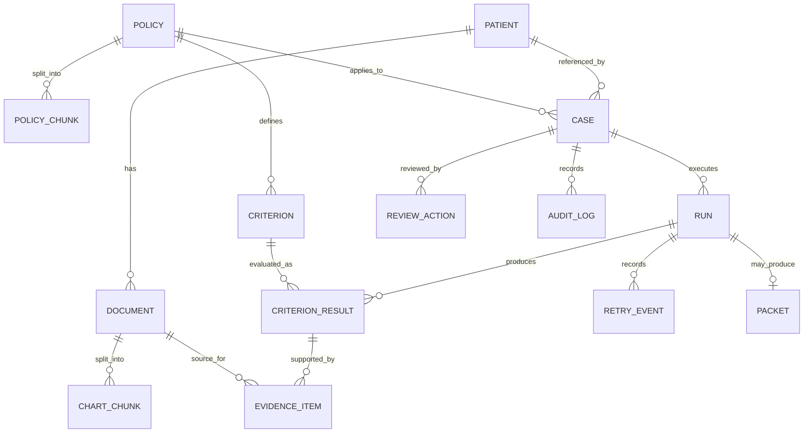

# AuthOS — Logical Data Model and Database Decisions

**Status:** Logical baseline. Exact SQL types, constraints, migration files and embedding dimensions must be fixed when implementation starts.

## Design principles

- PostgreSQL is the single MVP persistence service for case/workflow data, chart text, policy chunks, full-text indexes, vector embeddings and audit events.
- Synthetic source documents remain the source of truth. Chunks are derived retrieval artifacts and must retain parent/source identifiers.
- Every evidence item must point to a source document and patient, and preserve the exact quote/source span used for verification.
- Do not store only opaque LLM output JSON when important fields are queryable and safety-relevant.
- Store model/provider, prompt/version, retrieval configuration and run identifiers in audit metadata sufficient to reproduce a demo evaluation without storing secrets.

## Logical entities

| Entity | Key fields and constraints |
|---|---|
| `patients` | `patient_id` primary key; synthetic-only marker; no real identifiers. |
| `documents` | `document_id` primary key; `patient_id` foreign key; document type, date, title, source label, full text, content hash. |
| `chart_chunks` | `chunk_id`; parent `document_id`; `patient_id`; chunk ordinal/text; document date; embedding; `tsvector`. |
| `policies` | `policy_id`; title, payer label (synthetic), service, version, effective date, content hash. |
| `policy_chunks` | `chunk_id`; parent `policy_id`; section/ordinal/text; embedding; `tsvector`. |
| `cases` | `case_id`; patient FK; service; policy FK; lifecycle state; created/updated timestamps. |
| `criteria` | policy/version FK; stable criterion ID; criterion text; required-facts schema; duration thresholds; exception references. |
| `runs` | `run_id`; case FK; status; config/model/prompt version; start/end timestamps; error code. |
| `criterion_results` | run FK + criterion ID; status enum; verification flag; missing facts; validator flags; structured payload. Unique per run/criterion. |
| `evidence_items` | result FK; source document/chunk FK; patient ID; exact quote or offsets; date; retrieval round; verification outcome. |
| `retry_events` | run/result FK; round number; query label/text appropriate for synthetic demo; found/missing facts; sufficiency result. |
| `review_actions` | case/run FK; action enum; reviewer identity when available; note; timestamp. |
| `packets` | case/run FK; status; rendered content or structured snapshot; finalization timestamp; reviewer action reference. |
| `audit_log` | event ID; case/run FK; event type; structured non-secret metadata; timestamp. Append-only by application policy. |

## Relationships

## Indexing and retrieval

- B-tree indexes for patient, case, policy version, document date, run state and foreign keys.
- GIN indexes for PostgreSQL `tsvector` columns.
- pgvector HNSW or IVFFlat index only after choosing a compatible pgvector version and measuring dataset size; document the choice in an ADR.
- Metadata filters must enforce `patient_id`/case ownership before ranking. Never rely on semantic similarity to separate patients.
- Embedding model and vector dimension are configuration-bound; re-embedding/migration behavior must be documented if the model changes.

## Data integrity rules

1. Every chart chunk belongs to exactly one document and patient.
2. Every evidence item source must belong to the case's patient.
3. Evidence quote must match the source text exactly, or a validated start/end span must reproduce it exactly.
4. Every criterion result references a criterion from the policy version attached to the case.
5. A final packet references the exact run and policy version used to generate it.
6. Review/finalization actions are auditable and cannot silently rewrite prior run results.
7. `MET` cannot survive failed mandatory validators.

## Migration approach

Use versioned SQL migrations (Alembic if the team adopts SQLAlchemy; otherwise choose one migration system explicitly). Schema changes must be forward-reviewed and exercised against a fresh database and an upgraded database. Do not let ad hoc startup code silently mutate schema.

## Open decisions before schema implementation

- ORM versus SQL-first access.
- Alembic versus a SQL migration tool.
- Exact enums versus checked text fields for status/state.
- Whether packet content is stored as a snapshot, rendered on demand, or both.
- Embedding provider/model and vector dimension.
- Retention/deletion behavior for future non-synthetic deployments (out of MVP scope but release-blocking for real data).
